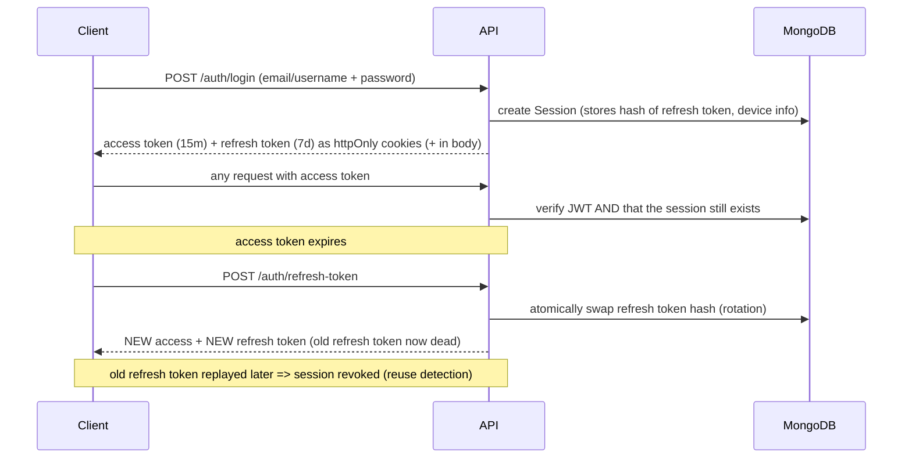

# Auth Service

Production-style **authentication & authorization backend** (Node.js, Express 5, MongoDB). Drop it into any project as the auth layer.

- JWT **access + refresh tokens**, stored in httpOnly cookies (or sent as Bearer tokens)
- **Per-device sessions**: list devices, log out one device, log out all devices
- **Refresh-token rotation + reuse detection** (stolen-token defense)
- **Rate limiting** per route + **account lockout** after repeated failed logins
- Email verification, forgot/reset password, password-changed notices
- **Role-based access control** (user / admin) with admin user management
- Validation, centralized error handling with machine-readable error codes
- 42 integration tests

## Tech stack

Node 20+ (ESM) · Express 5 · MongoDB + Mongoose 9 · jsonwebtoken · bcrypt · express-validator · express-rate-limit · helmet · cors · cookie-parser · morgan · nodemailer + mailgen · node:test + supertest

## Project structure

```
src/
  config/env.js            validated env (fails fast with a clear message)
  db/index.js              mongoose connect / disconnect
  models/                  user.models.js, session.models.js
  services/                token.service.js (JWT), session.service.js (create / rotate / revoke)
  controllers/             auth, user, admin, healthcheck
  routes/                  auth, user, admin, healthcheck
  middlewares/             auth (verifyJWT, authorizeRoles, requireVerifiedEmail),
                           rate-limit, validator, sanitize, error
  validators/              express-validator rule sets
  utils/                   ApiError, ApiResponse, asyncHandler, mail, cookies, crypto, password, constants
  scripts/seed-admin.js    create the first admin
  app.js                   middleware pipeline
  index.js                 bootstrap + graceful shutdown
tests/                     integration tests (+ helpers)
```

## Getting started

```bash
npm install
cp .env.example .env        # then fill in values (see table below)
npm run dev                 # nodemon
```

Generate secrets: `node -e "console.log(require('crypto').randomBytes(48).toString('hex'))"` (run twice: access + refresh must differ).

Without SMTP settings (dev), emails are **printed in the console** (the verification / reset links are in the log).

Create the first admin (no public API can create admins by design):

```bash
ADMIN_EMAIL=you@example.com ADMIN_USERNAME=admin ADMIN_PASSWORD='StrongPass123' npm run seed:admin
```

Tests: `npm test` (uses an in-memory MongoDB via `mongodb-memory-server`; or set `TEST_MONGODB_URI` to use your own).

## Environment variables

| Variable                                       | Default                              | Meaning                                                                         |
| ---------------------------------------------- | ------------------------------------ | ------------------------------------------------------------------------------- |
| `NODE_ENV`                                     | development                          | `production` forces secure cookies, hides error details/stacks                  |
| `PORT`                                         | 8080                                 | Server port                                                                     |
| `APP_NAME`                                     | Auth Service                         | Used in emails                                                                  |
| `APP_BASE_URL`                                 | http://localhost:PORT                | Public URL of this API (verification link)                                      |
| `CORS_ORIGIN`                                  | http://localhost:5173                | Comma-separated allowed frontend origins. `*` is rejected (cookies)             |
| `TRUST_PROXY`                                  | 0                                    | Number of reverse proxies in front (correct client IP for rate limiting)        |
| `MONGODB_URI`                                  | **required**                         | Mongo connection string                                                         |
| `ACCESS_TOKEN_SECRET` / `REFRESH_TOKEN_SECRET` | **required**                         | ≥32 chars each, must differ                                                     |
| `ACCESS_TOKEN_EXPIRY` / `REFRESH_TOKEN_EXPIRY` | 15m / 7d                             | JWT lifetimes                                                                   |
| `COOKIE_SAMESITE`                              | lax                                  | `lax`/`strict`/`none` (`none` needs HTTPS)                                      |
| `COOKIE_DOMAIN`                                | –                                    | Optional cookie domain                                                          |
| `BCRYPT_SALT_ROUNDS`                           | 12                                   | Hash cost                                                                       |
| `REQUIRE_EMAIL_VERIFICATION`                   | true                                 | Block login until email verified                                                |
| `MAX_LOGIN_ATTEMPTS` / `LOCK_TIME_MINUTES`     | 5 / 15                               | Lockout policy per account                                                      |
| `MAX_SESSIONS_PER_USER`                        | 10                                   | Oldest session evicted beyond this                                              |
| `REFRESH_REUSE_GRACE_SECONDS`                  | 10                                   | Window where a just-rotated token is treated as a concurrent request, not theft |
| `RATE_LIMIT_ENABLED`                           | true                                 | Master switch for rate limiters                                                 |
| `MAILTRAP_SMTP_HOST/PORT/USER/PASS`            | –                                    | SMTP. Empty host = console mail (dev). Required in production                   |
| `MAIL_FROM`                                    | `"APP_NAME" <no-reply@example.com>`  | Sender                                                                          |
| `FORGOT_PASSWORD_REDIRECT_URL`                 | http://localhost:5173/reset-password | Frontend reset page; token appended as `/<token>`                               |

## How authentication works



Key ideas:

- **Sessions in the DB** (one per device) make "logout everywhere" and instant revocation possible. `verifyJWT` checks the session on every request, so logout takes effect immediately, not when the token expires.
- **Rotation**: every refresh invalidates the previous refresh token. Replaying an old one (outside the grace window) means theft or a bug, so that session is revoked and the user must log in again. Within the grace window (default 10s) a replay returns a retryable `409 TOKEN_RECENTLY_ROTATED` so two browser tabs refreshing simultaneously don't log the user out.
- Tokens carry only `sub` + `sid`. The role is read from the DB on every request, so role changes/deactivation apply instantly.
- One-time tokens (email verification 24h, password reset 15m) are random 32 bytes, stored **hashed**, single-use.

## API reference

Base URL: `/api/v1`. Auth = send `Authorization: Bearer <accessToken>` **or** rely on the `accessToken` cookie.

### Response format

Success:

```json
{ "statusCode": 200, "data": {}, "message": "…", "success": true }
```

Error (stack only in development):

```json
{
    "statusCode": 422,
    "data": null,
    "message": "Validation failed",
    "success": false,
    "code": "VALIDATION_ERROR",
    "errors": [{ "field": "password", "message": "…" }]
}
```

Branch on `code`, never on `message`.

### Error codes

| code                     | status  | meaning                                                        |
| ------------------------ | ------- | -------------------------------------------------------------- |
| `VALIDATION_ERROR`       | 422     | Invalid input (`errors[]` has per-field messages)              |
| `INVALID_CREDENTIALS`    | 401     | Wrong email/username/password (same message for unknown users) |
| `ACCOUNT_LOCKED`         | 423     | Too many failed logins; wait `LOCK_TIME_MINUTES`               |
| `ACCOUNT_DISABLED`       | 401/403 | Deactivated by an admin                                        |
| `EMAIL_NOT_VERIFIED`     | 403     | Verify email first                                             |
| `TOKEN_MISSING`          | 401     | No token supplied                                              |
| `TOKEN_INVALID`          | 400/401 | Malformed/tampered/used token                                  |
| `TOKEN_EXPIRED`          | 401     | Access token expired → call refresh                            |
| `TOKEN_RECENTLY_ROTATED` | 409     | Concurrent refresh; retry with the latest cookie/token         |
| `TOKEN_REUSE_DETECTED`   | 401     | Old refresh token replayed; session revoked                    |
| `SESSION_REVOKED`        | 401     | Session was logged out / revoked                               |
| `FORBIDDEN`              | 403     | Role not allowed / CORS origin blocked                         |
| `NOT_FOUND`              | 404     | Resource/route missing                                         |
| `CONFLICT`               | 409     | Duplicate email/username                                       |
| `RATE_LIMITED`           | 429     | Too many requests (see `Retry-After` header)                   |
| `PAYLOAD_TOO_LARGE`      | 413     | Body over 16 KB                                                |
| `BAD_REQUEST`            | 400     | Malformed JSON / bad request                                   |
| `INTERNAL_ERROR`         | 500     | Unexpected server error                                        |

### Rate limits (per IP)

| Limiter  | Applied to                                          | Limit                                          |
| -------- | --------------------------------------------------- | ---------------------------------------------- |
| global   | everything                                          | 300 / 15 min                                   |
| register | `POST /auth/register`                               | 10 / hour                                      |
| login    | `POST /auth/login`                                  | 10 **failed** / 15 min (successes don't count) |
| email    | forgot-password, resend-email-verification          | 5 / 15 min                                     |
| password | reset-password, change-password, `DELETE /users/me` | 10 / 15 min                                    |
| refresh  | `POST /auth/refresh-token`                          | 60 / 15 min                                    |

Plus per-account lockout (default 5 wrong passwords → 15 min lock). The default store is in-memory; with several instances use a shared store such as Redis (`rate-limit-redis`).

### Routes overview

| Method | Path                                    | Auth          | Purpose                                        |
| ------ | --------------------------------------- | ------------- | ---------------------------------------------- |
| GET    | `/healthcheck`                          | –             | Liveness + DB state (503 if DB down)           |
| POST   | `/auth/register`                        | –             | Create account, send verification email        |
| GET    | `/auth/verify-email/:verificationToken` | –             | Verify email (link from email)                 |
| POST   | `/auth/resend-email-verification`       | –             | Send a new verification link                   |
| POST   | `/auth/login`                           | –             | Log in (email **or** username)                 |
| POST   | `/auth/refresh-token`                   | refresh token | Rotate tokens                                  |
| POST   | `/auth/forgot-password`                 | –             | Email a reset link                             |
| POST   | `/auth/reset-password/:resetToken`      | –             | Set a new password via emailed token           |
| POST   | `/auth/logout`                          | user          | Log out this device                            |
| POST   | `/auth/logout-all`                      | user          | Log out all devices (optionally keep this one) |
| POST   | `/auth/change-password`                 | user          | Change password, log out other devices         |
| GET    | `/auth/sessions`                        | user          | List active devices                            |
| DELETE | `/auth/sessions/:sessionId`             | user          | Log out one specific device                    |
| GET    | `/users/me`                             | user          | Current user                                   |
| PATCH  | `/users/me`                             | user          | Update fullName / username / avatarUrl         |
| DELETE | `/users/me`                             | user          | Delete own account (password required)         |
| GET    | `/admin/users`                          | admin         | List users (pagination, search, role filter)   |
| PATCH  | `/admin/users/:userId/role`             | admin         | Change role                                    |
| PATCH  | `/admin/users/:userId/status`           | admin         | Activate / deactivate (kills sessions)         |

### Route details

**`GET /healthcheck`** → `200 { status:"ok", database:"connected", uptimeSeconds, timestamp }`, or `503` when Mongo isn't connected.

**`POST /auth/register`** body `{ email, username, password, fullName? }`
Password: 8–64 chars, ≥1 lowercase, ≥1 uppercase, ≥1 number. Username: 3–30 chars, letters/numbers/underscore (stored lowercase). `role` in the body is ignored. → `201 { user }` + verification email. Errors: `422`, `409 CONFLICT`.

**`GET /auth/verify-email/:verificationToken`** → `200`. Token is single-use, valid 24h. Errors: `400 TOKEN_INVALID`, `422` (malformed token).

**`POST /auth/resend-email-verification`** body `{ email }` → always `200` with the same message (no account enumeration); email is sent only if the account exists and is unverified.

**`POST /auth/login`** body `{ email | username, password }`
→ `200 { user, accessToken, refreshToken }` and sets cookies `accessToken` (path `/`) and `refreshToken` (path `/api/v1/auth`, so it is only sent to auth routes). Browser apps use the cookies; mobile/Postman can use the body tokens.
Errors: `401 INVALID_CREDENTIALS`, `423 ACCOUNT_LOCKED`, `403 EMAIL_NOT_VERIFIED`, `403 ACCOUNT_DISABLED`, `422`.

**`POST /auth/refresh-token`** refresh token from the cookie, or body `{ refreshToken }` → `200 { accessToken, refreshToken }` (new pair, cookies updated). Errors: `401 TOKEN_MISSING | TOKEN_INVALID | TOKEN_EXPIRED | TOKEN_REUSE_DETECTED | SESSION_REVOKED`, `409 TOKEN_RECENTLY_ROTATED` (retry).

**`POST /auth/forgot-password`** body `{ email }` → always `200` (same message either way). Sends a link to `FORGOT_PASSWORD_REDIRECT_URL/<token>` (valid 15 min).

**`POST /auth/reset-password/:resetToken`** body `{ newPassword }` → `200`. Single-use; **logs out every device**, unlocks the account, sends a "password changed" email. Errors: `400 TOKEN_INVALID`, `422`.

**`POST /auth/logout`** (auth) → `200`, deletes this session and clears cookies. The access token stops working immediately.

**`POST /auth/logout-all`** (auth) body `{ keepCurrent?: boolean }` → `200 { revokedSessions }`. With `keepCurrent: true` only the _other_ devices are logged out.

**`POST /auth/change-password`** (auth) body `{ currentPassword, newPassword }` → `200 { revokedSessions }`. New password must differ and meet the policy; all other devices are logged out, this one stays.

**`GET /auth/sessions`** (auth) → `200 { sessions: [{ id, userAgent, ip, createdAt, lastUsedAt, expiresAt, isCurrent }] }`.

**`DELETE /auth/sessions/:sessionId`** (auth) → `200 { loggedOutCurrentDevice }`. Only your own sessions; others return `404`.

**`GET /users/me`** (auth) → `200 { user }`.

**`PATCH /users/me`** (auth) body: any of `{ fullName, username, avatarUrl }` (at least one). Only these fields are accepted (`role`, `isActive`… are ignored). `409` if the username is taken.

**`DELETE /users/me`** (auth) body `{ password }` → `200`, deletes the account and all sessions. `401` on wrong password.

**`GET /admin/users?page=1&limit=10&search=text&role=user`** (admin) → `200 { users, pagination:{ page, limit, total, totalPages } }`. `limit` ≤ 100. `search` matches username/email/fullName (literal text, regex characters are escaped).

**`PATCH /admin/users/:userId/role`** (admin) body `{ role: "user" | "admin" }`. Applies immediately. You cannot change your own role.

**`PATCH /admin/users/:userId/status`** (admin) body `{ isActive: boolean }`. Deactivating revokes all of that user's sessions at once. You cannot deactivate yourself.

### Quick curl demo

```bash
curl -c jar -X POST localhost:8000/api/v1/auth/register -H 'Content-Type: application/json' \
  -d '{"email":"me@example.com","username":"me","password":"Passw0rdOK"}'
# open the link printed in the console (or your inbox), then:
curl -c jar -X POST localhost:8000/api/v1/auth/login -H 'Content-Type: application/json' \
  -d '{"email":"me@example.com","password":"Passw0rdOK"}'
curl -b jar localhost:8000/api/v1/users/me
curl -b jar -c jar -X POST localhost:8000/api/v1/auth/refresh-token
curl -b jar -X POST localhost:8000/api/v1/auth/logout-all -H 'Content-Type: application/json' -d '{}'
```

## Security measures

| Threat                              | Defense                                                                                                                 |
| ----------------------------------- | ----------------------------------------------------------------------------------------------------------------------- |
| Password DB leak                    | bcrypt (cost 12), `password` never selected/returned (`select:false` + `toJSON` strip)                                  |
| Token DB leak                       | Refresh tokens and one-time tokens stored only as SHA-256 hashes                                                        |
| Stolen refresh token                | Rotation + reuse detection, per-device sessions, instant revoke                                                         |
| Stolen access token                 | Short life (15m) + session checked on every request                                                                     |
| Brute force                         | Per-IP rate limits + per-account lockout                                                                                |
| User enumeration                    | Same error/message for unknown user vs wrong password, forgot/resend always 200, dummy bcrypt compare for unknown users |
| XSS token theft                     | httpOnly cookies                                                                                                        |
| CSRF                                | SameSite cookies + JSON-only API + refresh cookie scoped to `/api/v1/auth`                                              |
| NoSQL injection                     | `$`/`.` keys stripped + validators require strings                                                                      |
| Mass assignment                     | Whitelisted fields; `role` can't be set by users                                                                        |
| Algorithm confusion                 | Pinned `HS256`, separate secrets for access/refresh, issuer checked                                                     |
| Oversized payloads / header attacks | 16 KB body limit, helmet                                                                                                |
| Info leak in errors                 | Stack/internal messages hidden in production                                                                            |

## Reusing it in another project

Copy `src/` (and the dependencies). Protect any router:

```js
import {
    verifyJWT,
    authorizeRoles,
    requireVerifiedEmail,
} from "./middlewares/auth.middlewares.js";
import { UserRolesEnum } from "./utils/constants.js";

router.get("/orders", verifyJWT, listOrders); // logged-in users
router.delete(
    "/orders/:id",
    verifyJWT,
    authorizeRoles(UserRolesEnum.ADMIN),
    removeOrder,
);
router.post("/posts", verifyJWT, requireVerifiedEmail, createPost); // verified emails only
// inside any handler: req.user (the user doc), req.sessionId
```

Add roles in `src/utils/constants.js`.

## Production checklist

- HTTPS only; `NODE_ENV=production`; set `TRUST_PROXY` to the number of proxies in front.
- Real SMTP credentials; strong random secrets; never commit `.env`.
- Several instances → Redis store for rate limiting.
- Frontend on a different _site_: `COOKIE_SAMESITE=none` (HTTPS required) and add the origin to `CORS_ORIGIN`.

## Design trade-offs (good interview material)

- **Session lookup per request** costs one DB read but gives real logout/revocation. Pure stateless JWTs can't do that.
- **Grace window** on rotation trades a tiny detection delay (≤10s) for not logging users out on concurrent refreshes.
- **Account lockout** can be abused to lock someone out (DoS); mitigated by being temporary + password reset unlocks.
- Email verification link is a GET: some mail scanners prefetch links and could consume the token. A POST confirmation page on the frontend avoids that.

## Roadmap ideas

2FA/TOTP, OAuth (Google/GitHub), avatar upload (multer + Cloudinary), Redis for rate limits/session cache, audit log, Docker + CI, OpenAPI/Swagger docs.
